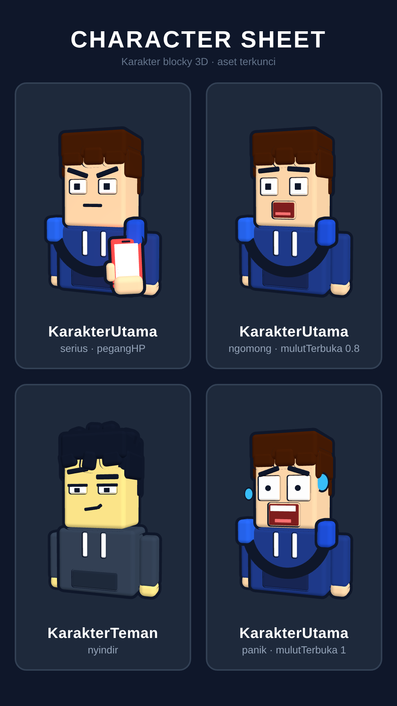

# tiktok-animasi

Fondasi karakter animasi **3D blocky** untuk video komedi TikTok, dibuat dengan [Remotion](https://www.remotion.dev) + Three.js.



## Pakai

```bash
npm install
npm run studio   # buka Remotion Studio
npm run sheet    # render ulang out/character-sheet.png
```

```tsx
import {KarakterUtama, KarakterTeman} from './components/KarakterBlocky';

<KarakterUtama ekspresi="ngomong" mulutTerbuka={0.8} pegangHP />
<KarakterTeman ekspresi="nyindir" />
```

Props: `ekspresi` (`serius` | `ngomong` | `nyindir` | `panik`), `mulutTerbuka` (0–1), `pegangHP` (khusus `KarakterUtama`), `scale`.

Aturan konsistensi karakter ada di [`CLAUDE.md`](CLAUDE.md).
